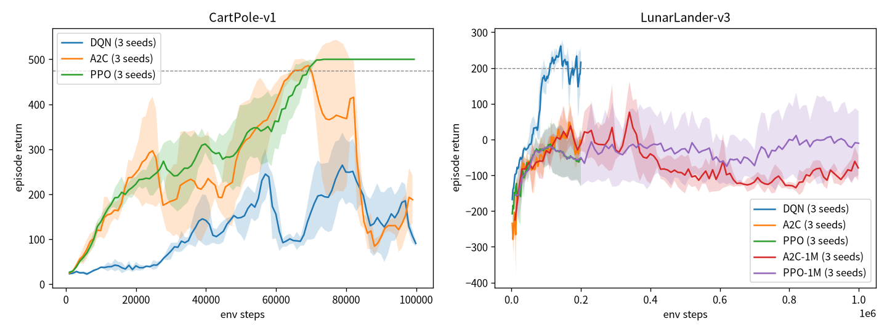

# 强化学习在序列决策中的对比研究：DQN / A2C / PPO

在 **CartPole-v1** 和 **LunarLander-v3**（gymnasium Box2D）上，用 PyTorch 从零实现 DQN、A2C、PPO，各跑 3 个随机种子，画学习曲线并分析。代码约 260 行。

## 1. 实现要点

| | DQN (`rlseq/dqn.py`) | A2C (`rlseq/actor_critic.py`) | PPO (`rlseq/actor_critic.py`) |
|---|---|---|---|
| 类型 | 离策略、值函数 | 同策略、Actor-Critic | 同策略、Actor-Critic |
| 采样 | 单环境，每步更新 1 次 | 8 个并行环境 × 8 步 | 8 个并行环境 × 128 步 |
| 关键技巧 | 经验回放 10 万、目标网络软更新 τ=0.005、ε 30% 步数内 1→0.05、Huber | n-step 回报（λ=1）、每批 1 次更新 | GAE λ=0.95、裁剪 0.2、10 epoch × 256 小批量、优势标准化 |
| 网络 | MLP 256×2 | 策略/价值各一个 MLP 128×2 (tanh) | 同 A2C |

公共细节：γ=0.99；**截断（时间上限）不当作终止**——DQN 存真实末状态且 done=0，A2C/PPO 在截断步把 γV(末状态) 加进奖励自举（用 gymnasium `SAME_STEP` 自动重置的 `final_obs`）；熵系数 0.01、梯度裁剪。

步数预算：CartPole 10 万步；LunarLander 20 万步（三种算法同预算）。由于 A2C/PPO 墙钟很快，补充跑了 LunarLander 100 万步的 A2C/PPO（`-1M`）。

## 2. 运行（Windows，建议放 D:\Projects\rl-sequential-decision）

```powershell
cd D:\Projects\rl-sequential-decision
python -m venv .venv
.\.venv\Scripts\Activate.ps1
pip install --index-url https://download.pytorch.org/whl/cpu torch
pip install numpy matplotlib "gymnasium[box2d]"    # Windows 上 box2d 若编译失败，可先 pip install swig
python run.py --env CartPole-v1 --algo ppo --seed 0 --steps 100000   # 单个实验
python plot.py                                                       # 画图 + 汇总表
```
批量跑全部实验可用 `run_all.sh`（Linux/Git Bash，8 进程并行）。

## 3. 实际结果（本机：Linux 容器、每进程单线程 CPU、torch 2.14.1+cpu、gymnasium 1.4.0）



曲线为 3 个种子的“最近 20 回合平均回报”的均值 ± 标准差。汇总（`results/summary.md`，原始数据 `results/*.json`，日志 `logs_run*.txt`）：

| 环境 | 算法 | 种子数 | 最后 20 回合平均回报 (均值 ± 标准差) | 训练中峰值(20回合滑动均值, 种子平均) | 达到阈值所需步数（各种子） | 单次耗时(s) |
|---|---|---|---|---|---|---|
| CartPole-v1 | DQN | 3 | 85.0 ± 9.6 | 326.2 | 未达到 / 未达到 / 未达到 | 167 |
| CartPole-v1 | A2C | 3 | 212.7 ± 75.2 | 498.4 | 64k / 25k / 64k | 8 |
| CartPole-v1 | PPO | 3 | 500.0 ± 0.0 | 500.0 | 69k / 62k / 69k | 13 |
| LunarLander-v3 | DQN | 3 | 217.7 ± 43.9 | 267.3 | 81k / 117k / 90k | 329 |
| LunarLander-v3 | A2C | 3 | -10.9 ± 17.0 | 94.6 | 未达到 ×3 | 23 |
| LunarLander-v3 | PPO | 3 | -50.9 ± 78.7 | 26.1 | 未达到 ×3 | 31 |
| LunarLander-v3 | A2C-1M | 3 | -83.9 ± 35.9 | 169.9 | 未达到 / 未达到 / 283k | 92 |
| LunarLander-v3 | PPO-1M | 3 | -11.6 ± 90.6 | 77.2 | 未达到 ×3 | 129 |

阈值：CartPole 475、LunarLander 200（20 回合滑动均值）。耗时为 8 进程并行时的单进程墙钟。

## 4. 结论分析

1. **CartPole：PPO 最稳**。3 个种子都在 6~7 万步达到 500 满分并保持住；A2C 也能达到（峰值 498），但随后崩溃回 212 左右——单批一次更新、无比率约束，一次坏更新就能毁掉策略，这正是 PPO 裁剪目标要解决的问题。
2. **CartPole 上本实现的 DQN 不稳定**：峰值 326，期末只有 85。典型原因：200 步左右的长回合 + 自举目标导致 Q 值过估计与“灾难性遗忘”（回放池被近期好数据占满后，失败状态样本变少）。可用 Double DQN、更小学习率、更大回放池或早停缓解。
3. **LunarLander：DQN 样本效率最高**。20 万步内 3 个种子都超过 200（8~12 万步），最终 217.7 ± 43.9。离策略 + 经验回放让每个样本被反复利用；奖励稠密时这一优势很明显。
4. **同样 20 万步，A2C/PPO 在 LunarLander 远未收敛**；给到 100 万步（墙钟时间与 DQN 20 万步相当）也没有稳定达到 200，PPO-1M 种子间方差很大（-11.6 ± 90.6），A2C-1M 期末反而比峰值低很多。说明本实现的同策略方法在 LunarLander 上需要更多步数和调参（观测归一化、学习率退火、更大 batch 等），这里**没有**做超参搜索。
5. **取舍**：样本效率（DQN 胜）vs 墙钟/稳定性（PPO 胜，CartPole 上 13 秒完成）。“哪个算法更好”强烈依赖环境与预算；3 个种子仍偏少，表中标准差说明结论只能看作趋势。

## 5. 面试讲解要点
- 设计：统一接口 `train(env, steps, seed) -> [(step, return)]`，按环境步数而非回合对齐比较；多种子均值 ± 标准差。
- 难点：截断 vs 终止的正确处理（影响价值自举）；向量化环境自动重置时取真实末状态；GAE 在回合边界清零。
- 局限：每个算法一套固定超参、未调参；种子数少；DQN 未用 Double/Dueling/PER；A2C/PPO 未做观测归一化。
